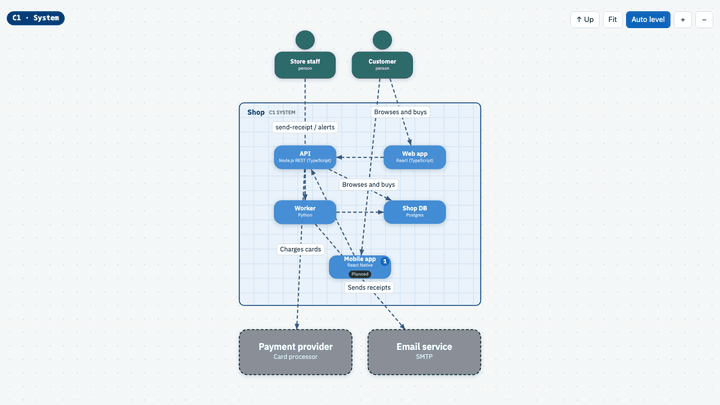
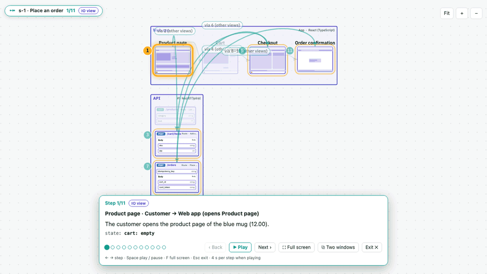
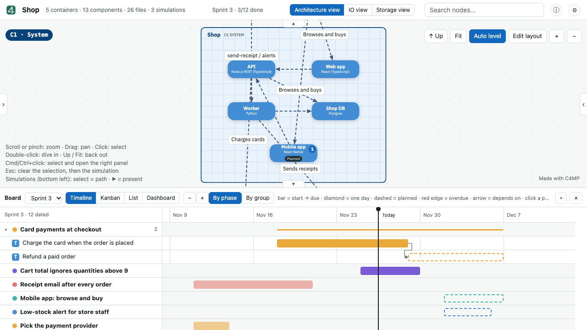
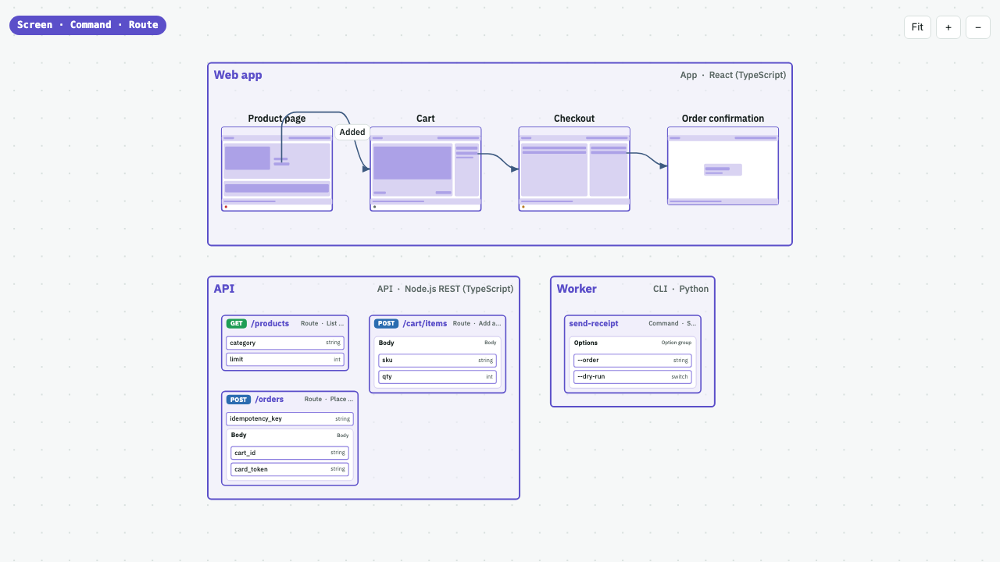
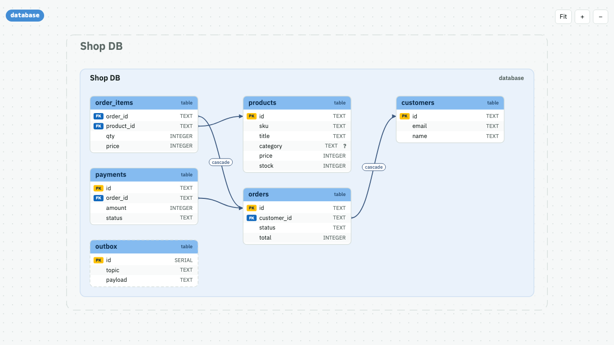

<p align="center">
  <picture>
    <source media="(prefers-color-scheme: dark)" srcset="brand/png/c4mp-logo-dark@2x.png">
    
  </picture>
</p>

<p align="center"><strong>C4MP: your crew, your map, your plan, in one camp.</strong></p>

C4MP is an open-source architecture map you and your AI agents share: plan, code and board in one place, checked against each other. The 4 is the C4 model's four zoom levels (system, containers, components, code); C, M, P are Crew, Map, Plan.

<p align="center">
  <picture>
    <source media="(prefers-color-scheme: dark)" srcset="docs/media/hero-dark.gif">
    
  </picture>
</p>

Watch the trailer: [docs/media/trailer.mp4](docs/media/trailer.mp4) (it moves to YouTube later).

Try it in your browser: **[live demo](https://tgsoon2002.github.io/c4mp/)** (a made-up Shop project, no install).

## Install

```sh
# Homebrew
brew install tgsoon2002/c4mp/c4mp

# or the install script (macOS, Linux)
curl -fsSL https://github.com/tgsoon2002/c4mp-releases/releases/latest/download/install.sh | sh

# Windows (PowerShell)
irm https://github.com/tgsoon2002/c4mp-releases/releases/latest/download/install.ps1 | iex

# or from source (Node 20+)
npm ci && npm run build
```

Then, in any repo: `c4mp init`, then `c4mp serve` to open the live map in your browser (`c4mp serve --link` prints its link again later). The command is `c4mp`; the old `c4pm` still works as an alias.

## What you get

### The zoomable map
C4 levels built from your code: system, containers, components, functions. Write the intended architecture as `.c4` plan files next to the code and `c4mp check` compares plan and code (done work with no code, code nobody planned, stubs, late work).

### Simulations
Walk a flow step by step over the map: which screens, components, records or functions each step touches, with captions and sample rows.

<picture>
  <source media="(prefers-color-scheme: dark)" srcset="docs/media/sim-dark.gif">
  
</picture>

### The board
Tasks, features, issues and bugs (b-items) linked to the plan's c-items, with a kanban view, so each piece of work shows where in the architecture it lands.

<picture>
  <source media="(prefers-color-scheme: dark)" srcset="docs/media/board-dark.png">
  
</picture>

### IO and storage views
Besides the architecture view: the IO view (screens, regions, controls, commands, routes) and the storage view (stores, records and fields from the plan and your schema files, checked against each other).

<picture>
  <source media="(prefers-color-scheme: dark)" srcset="docs/media/io-dark.png">
  
</picture>
<picture>
  <source media="(prefers-color-scheme: dark)" srcset="docs/media/storage-dark.png">
  
</picture>

## Use it with AI agents

- **MCP server:** `c4mp mcp --repo .` serves the code queries, `plan_show`, `check`, `status` and the simulation tools to an AI client. Put it in the client's MCP config.
- **Code queries:** `c4mp find`, `show`, `outline`, `deps`, `calls`, `callers` read the code through the same map, so an agent finds and traces code without grepping.
- **Live map:** `c4mp serve` shows the map in your browser and reloads it when code, plan or board change, so you watch what the agent changes.

The agent guide ships with the tool: [guide/ai.md](guide/ai.md).

## What's new in 0.11.0

- Renamed from C4PM to C4MP; the command is `c4mp` and `c4pm` still works as an alias for 2 versions.
- `c4mp migrate` moves an old `.c4pm/` folder to `.c4mp/` (dry run by default, `--yes` to apply).
- The engine is now Apache-2.0.
- The page carries the C4MP brand: favicon, header badge and the C, M, P loading spinner.

<details>
<summary>Full list for 0.11.0</summary>

**Added**
- `c4mp migrate`: moves an old `.c4pm/` folder to `.c4mp/` (`git mv` in a git repo) and fixes the text in its `.gitignore`; dry run by default, `--yes` to apply; refuses when both folders exist.
- The page carries the C4MP brand: a favicon, a small tent-4 badge in the header, and the C, M, P loading spinner on the first load of a served page and while the live map rebuilds.

**Changed**
- Licence: the engine is now Apache-2.0 (was FSL-1.1-MIT).
- Renamed from C4PM to C4MP ("camp"). Command `c4mp`; `c4pm` stays as an alias for 2 versions and prints a note.
- Data folder `.c4mp/` for new repos; a repo with an old `.c4pm/` keeps working in it and prints a one-line note until you run `c4mp migrate`. If both exist, `.c4mp/` wins with a warning.
- `c4mp install` installs `c4mp` plus a `c4pm` alias next to it; git hooks call `c4mp` and fall back to `c4pm`.
- Config file `.c4mprc.json` (an old `.c4pmrc.json` is still read when the new one is missing); environment variables `C4MP_*` (the old `C4PM_*` names are still read); MCP server name `c4mp`; user folder `~/.c4mp`.

Older versions: [CHANGELOG.md](CHANGELOG.md).

</details>

## Licence

Apache-2.0, see [LICENSE](LICENSE) and [NOTICE](NOTICE). The name and logo are covered by [TRADEMARKS.md](TRADEMARKS.md).

## Contributing

See [CONTRIBUTING.md](CONTRIBUTING.md).

## Security

See [SECURITY.md](SECURITY.md).
